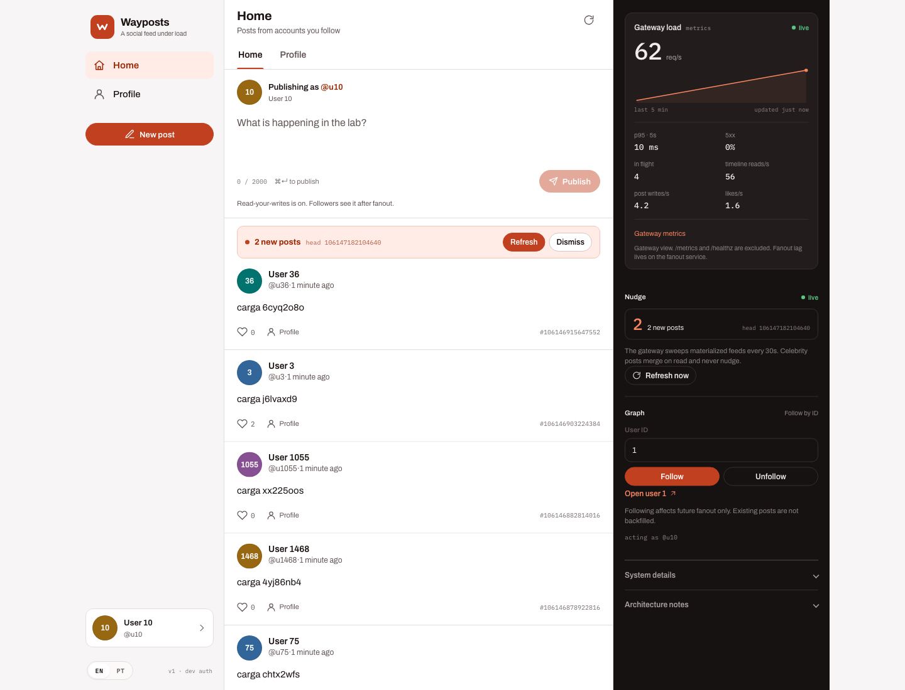
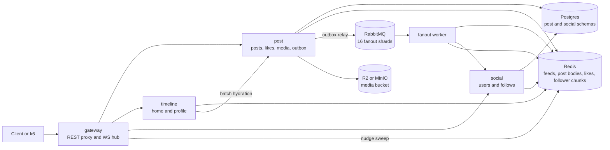
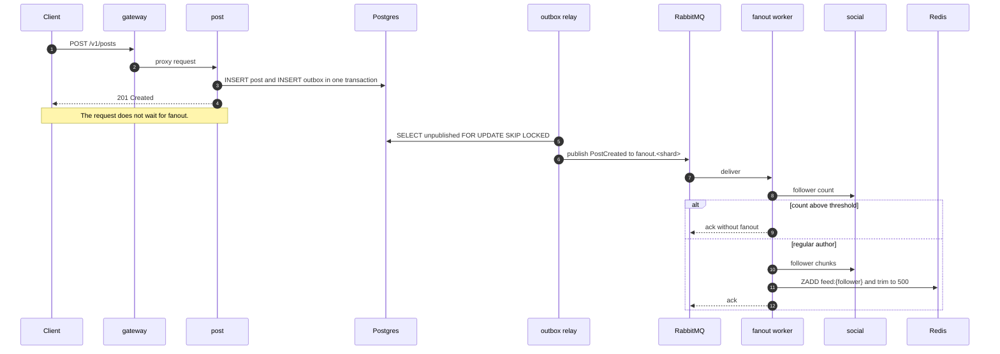
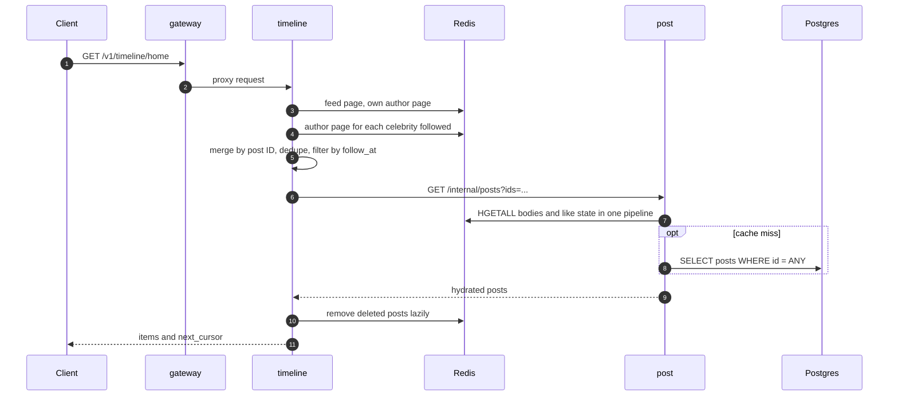

# Wayposts

**A load-test lab for a social feed design.** Wayposts implements the write and read
paths of a Twitter-style feed and measures where the design breaks under load. It is
not a product.

**English** | [Português (Brasil)](README.pt-BR.md)

[Quick start](#quick-start) · [API](#api) · [Architecture](#architecture) ·
[Load tests](#load-tests) · [Results](#phase-0-results) · [Development](#development) ·
[Known limits](#known-limits)

## What it does

- Publish a post with up to 2,000 characters and four images.
- Like and unlike with an idempotent Redis script and batched persistence.
- Follow and unfollow, with follower lists cached in chunks.
- Read a Home Timeline built by hybrid fanout: push for regular authors, merge for
  celebrities.
- Read a Profile Timeline.
- Soft-delete posts. Timelines drop deleted items lazily.
- Notify connected clients of new posts over WebSocket.
- Emit Prometheus metrics from every service.

Out of scope: replies, reposts, search, hashtags, DMs, persisted notifications,
ranking, moderation, and mobile apps.



The console in `web/` is the visual client for the API. It shows the home timeline,
writes, likes, follows, profiles, and the live nudge indicator. The right rail reads
the gateway's `/metrics` every 5 seconds and shows real request rate, p95, errors,
in-flight requests, timeline reads, writes, and likes. The interface is available in
English and Brazilian Portuguese.

## Quick start

Prerequisites: Go 1.26+ and Docker 28+ with Compose v2. The `go.mod` downloads the
toolchain automatically. k6 runs in a container.

```sh
make up        # Postgres, Redis, RabbitMQ, MinIO
make migrate
make seed      # 2,000 users, 3 celebrities, 400-follower cap for regular authors
make run       # builds and starts the five services
```

`make run` starts five processes:

| Service | Address | Role |
|---|---|---|
| `gateway` | `:8080` | REST proxy, dev auth, WebSocket hub, nudge sweep |
| `post` | `:8081` | Posts, likes, media, outbox, internal hydration |
| `timeline` | `:8082` | Home and Profile timelines, merge |
| `social` | `:8083` | Users, follows, follower cache |
| `fanout` | `:8084` | Fanout worker, health and metrics only |

In a second terminal:

```sh
make demo      # follows, a regular post, a celebrity post, a like, both timelines
make nudge     # WebSocket connection plus a new-post notification
make media     # presign, direct upload, and HEAD validation against MinIO
make web-install
make web-dev   # console at http://localhost:5173
```

The `web/` directory is a React console for the API. Locally it runs on Vite.
Production runs it as static assets on Cloudflare Workers. See
[`web/README.md`](web/README.md).

Stop the services with Ctrl-C in the `make run` terminal. Then:

```sh
make down      # stops containers, keeps the volume
make reset     # recreates containers and wipes data
```

`make seed` truncates tables and runs `FLUSHDB` by default. Stop the services first
with `./scripts/stop.sh`. Running it while fanout is active leaves the outbox and
caches inconsistent.

Default local ports are 5432 for Postgres, 6379 for Redis, 5672 and 15672 for
RabbitMQ, and 9000 and 9001 for MinIO. If one is busy, publish a different port in
`docker-compose.yml` and adjust `DATABASE_URL`, `REDIS_ADDR`, `RABBIT_URL`, or
`S3_ENDPOINT`. `scripts/dev.sh` wires MinIO into the post service. Set `MEDIA_BUCKET`
empty to run without uploads.

### First API calls

Development auth is a bearer token equal to the seeded user ID. This is not production
auth. Seed creates users `1..N`; users `1..CELEBS` are celebrities.

```sh
# user 10 publishes
curl -s -X POST localhost:8080/v1/posts \
  -H 'Authorization: Bearer 10' -H 'Content-Type: application/json' \
  -d '{"body":"hello"}'

# user 11 follows user 10
curl -s -X POST localhost:8080/v1/follow \
  -H 'Authorization: Bearer 11' -H 'Content-Type: application/json' \
  -d '{"followee_id":10}'

# user 11 reads the Home Timeline
curl -s 'localhost:8080/v1/timeline/home?limit=20' \
  -H 'Authorization: Bearer 11'
```

The first post may take a moment to appear because fanout is asynchronous. The
publisher sees its own post immediately through the read-your-writes path.

## API

All public routes go through the gateway and require a bearer token. The exceptions are
`/healthz` and `/metrics`, plus `/v1/ws`, which uses the `token` query parameter.

| Method | Path | Purpose |
|---|---|---|
| `POST` | `/v1/posts` | Create a post with `body` and optional `media` keys |
| `GET` | `/v1/posts/{id}` | Read one post |
| `DELETE` | `/v1/posts/{id}` | Soft-delete your own post |
| `POST` | `/v1/posts/{id}/likes` | Like a post |
| `DELETE` | `/v1/posts/{id}/likes` | Remove a like |
| `POST` | `/v1/media/presign` | Get signed upload URLs for image content types |
| `POST` | `/v1/follow` | Follow `followee_id` |
| `DELETE` | `/v1/follow/{id}` | Unfollow |
| `GET` | `/v1/users/{id}` | Read handle, display name, and follower count |
| `GET` | `/v1/timeline/home` | Home Timeline page |
| `GET` | `/v1/timeline/profile/{id}` | Profile Timeline page |
| `GET` | `/v1/ws?token={uid}&last_seen={postID}` | WebSocket nudge stream |
| `GET` | `/healthz` | Liveness |
| `GET` | `/metrics` | Prometheus metrics |

Timeline pages accept `before`, a post ID, and `limit`, default 20 and capped at 50.
The response is `{"items": [...], "next_cursor": <postID>}`.

`POST /v1/media/presign` accepts `{"items":[{"content_type":"image/png","size":70}]}`
and returns a key, a signed `PUT` URL, headers, and an expiry. The client uploads
directly to the bucket, then sends the key in `POST /v1/posts`. The API checks the
object with `HEAD`: it must exist, sit under the author's prefix, be an image, and stay
under `MEDIA_MAX_BYTES`, 10 MiB by default. Supported types are JPEG, PNG, and WebP.

## Architecture

Five deployables share Go packages. Postgres is the system of record. Redis serves the
materialized feed, cached post bodies, likes, and follower chunks. RabbitMQ carries one
`PostCreated` event per post to the fanout workers. Object storage holds media. The
optional console in `web/` is outside the fanout path. It calls the gateway over HTTPS
and WebSocket.

The core problem is fanout cost. Pushing a post into every follower's feed costs posts
times followers, so one post from an account with 10 million followers becomes 10
million writes. Wayposts splits authors at a threshold. Below it, the post is pushed
into each follower's feed. Above it, readers merge the author's recent posts at read
time. The lab exists to measure both sides of that split.



| Service | Responsibility | Data it owns |
|---|---|---|
| `gateway` | REST proxy, dev bearer auth, WebSocket connections, nudge sweep | No shared state. WS connections live in the instance |
| `post` | Create, read, delete posts, media validation, likes, outbox relay | Postgres schema `post`; Redis `post:{id}`, `author:{u}`, `likes:{post}` |
| `timeline` | Home and Profile timelines, merge, hydration | Reads Redis `feed:{u}`, `author:{u}`, `celeb_follows:{u}` |
| `social` | Users, follow graph, follower counts, follower cache | Postgres schema `social`; Redis `followers:{author}:{chunk}`, `celeb_follows:{u}` |
| `fanout` | Consume `PostCreated` and write feeds | No database of its own |

### Write path



A post commit and its event commit together. If the broker is down, the row stays
unpublished and the relay retries later. The relay runs every 50 ms, publishes up to
200 events per batch, and shards by author across 16 queues so a large account cannot
block every consumer.

Authors above `FANOUT_THRESHOLD`, 10,000 followers by default, are not pushed. Their
posts stay in the author index and the read path merges them. This keeps write cost
independent of the largest audiences. It moves work to readers instead.

Fanout is idempotent because each feed entry is a `ZADD` with `score = postID`.
Redelivery repeats the same write. The feed is capped at 500 entries.

### Read path



The Home Timeline merges four sources:

1. The materialized `feed:{u}` page.
2. The reader's own `author:{u}` page, so a new post appears before fanout finishes.
3. `author:{celeb}` for each celebrity in `celeb_follows:{u}`, filtered to posts
   created after the follow.
4. The page cursor, applied as `max = before` on every ZSET read.

Post bodies are hydrated in one batch call. The post service reads the Redis hashes in
a pipeline and falls back to Postgres for misses. Deleted posts are skipped and removed
from the feed on read, without a delete fanout.

The Profile Timeline reads only `author:{authorID}`, so it returns at most the 200 most
recent posts cached for that author.

### Design decisions

| Decision | Why | Cost |
|---|---|---|
| Hybrid fanout | Write cost stops growing with the largest audiences | Readers merge two sources and paginate across both |
| Feed of post IDs | One entry per post per follower, not a full body copy | Hydration needs 20 cache reads per page and a Postgres miss path |
| Transactional outbox plus sharded queues | No post is lost between commit and publish | At-least-once delivery, an outbox table that needs pruning, one relay process |
| 53-bit IDs | Exact as a `float64` ZSET score and as a JavaScript number | Custom epoch, 64 generator nodes, 64k IDs/s per node |
| Redis-first likes | No hot row in Postgres for a viral post | Up to 100 ms of likes lost on a crash, counter can lead the table |
| Chunked follower cache | One Redis read per 1,000 followers, not one per follower | Cache and table can diverge, reconstruction needs a generation check |
| Nudge by sweep | The write path does not know about WebSockets | Up to 30 s of delay, and celebrity posts do not trigger a nudge |
| Presigned media uploads | Image bytes never pass through the API | A separate `HEAD` check on post creation |

The full reasoning and alternatives are in [`docs/adr/`](docs/adr/). Domain vocabulary
is in [`CONTEXT.md`](CONTEXT.md).

### Data model

Postgres:

| Schema | Table | Purpose |
|---|---|---|
| `post` | `posts` | Body, media keys, creation time, soft-delete flag, like count |
| `post` | `likes` | Durable like records, the source for counter reconstruction |
| `post` | `outbox` | Unpublished events, drained by the relay |
| `social` | `users` | Handle, display name, materialized follower count |
| `social` | `follows` | Directed follow edges |

Redis:

| Key | Type | Contents | Retention |
|---|---|---|---|
| `feed:{u}` | ZSET | Post IDs, score equals ID | Cap 500 |
| `author:{u}` | ZSET | Last 200 post IDs for an author | Cap 200 |
| `post:{id}` | HASH | Body, counters, media, deleted flag | TTL 24 h plus LRU |
| `likes:{post}` | SET | User IDs that liked the post | TTL 7 d plus LRU |
| `followers:{author}:{chunk}` | SET | Up to 1,000 follower IDs | TTL 24 h |
| `followers_meta:{author}` | string | Chunk count, expires one hour before chunks | TTL 23 h |
| `followers_gen:{author}` | string | Cache generation for race detection | TTL 7 d |
| `celeb_follows:{u}` | ZSET | Celebrity to follow time | Maintained on follow |

Post bodies live 24 hours in Redis and then fall back to Postgres. Feed entries live
until the cap evicts them. Losing Redis loses the materialized feeds; there is no feed
rebuild from Postgres, so a restart requires reseeding.

### Targets and SLOs

| Assumption | Value |
|---|---|
| DAU | 20,000,000 |
| Posts per user per day | 10 |
| App opens per user per day | 10 |
| Followers per author | Power law, median ~150, p99 ~5k, max 1M |
| Likes per post | ~5 |
| Posts with media | ~20% |
| Concurrent WebSocket connections | 5 to 10% of DAU |

| Derived load | Average | Peak, ~4x |
|---|---|---|
| Posts/s | 2,315 | 9,260 |
| Timeline reads/s | 2,315 | 9,260 |
| Likes/s | 11,574 | 46,296 |
| Feed writes in ZADD/s | ~463k | ~1.85M |
| Media uploads/s | ~463 | ~1,852 |

| Operation | Target p99 |
|---|---|
| `POST /v1/posts` | 300 ms, excluding fanout |
| `GET /v1/timeline/home` and profile | 150 ms |
| Like and unlike | 100 ms |
| Fanout lag | p95 2 s, p99 10 s |
| 5xx rate | below 0.1% |
| Nudge delay | 30 s |

Saturation is the first plateau where an SLO breaks for 5 minutes in a row or errors
pass 1%. These are design targets, not measurements. The phase 0 numbers below are
measurements from one small deployment.

## Load tests

The load setup uses k6 in open model. Arrival rate is fixed and independent of latency.
A closed model hides the knee because slow responses reduce pressure. See
[`load/README.md`](load/README.md) for the full method.

```sh
./scripts/load.sh steady
RATE=200 DURATION=5m ./scripts/load.sh steady
START_RATE=50 MAX_RATE=1500 ENFORCE=0 ./scripts/load.sh ramp
```

| Scenario | Default | Purpose |
|---|---|---|
| `steady` | 50 iters/s for 2 min | Baseline and stability |
| `ramp` | 20 to 1,000 iters/s, 1 min warmup, 10 min ramp, 2 min hold | Find the knee and confirm it |
| `spike` | 100 iters/s, 10x for 60 s | Queue, backlog, recovery |
| `soak` | 80 iters/s for 30 min | Leaks, GC, TTL, connection growth |
| `celebrity` | 50 iters/s for 3 min, 10% celebrity writes | Merge path under load |
| `cold-cache` | 20 iters/s for 2 min after `make flush-posts` | Hydration with no post cache |

The default mix is 85% Home Timeline, 5% Profile Timeline, 7% post creation, and 3%
likes. `RATE` counts iterations, not requests. Thresholds enforce the SLO table and k6
exits with code 99 when one breaks. Use `ENFORCE=0` during a ramp and `ENFORCE=1` for
the final measurement.

Fanout lag is not an HTTP metric. Query it from Prometheus:

```promql
histogram_quantile(0.95, sum by (le) (rate(wayposts_fanout_lag_seconds_bucket[5m])))
sum(rate(wayposts_fanout_feed_writes_total[1m]))
sum by (result) (rate(wayposts_fanout_messages_total[1m]))
```

To reproduce the phase 0 graph locally:

```sh
make seed USERS=20000 FOLLOWS=200 CELEBS=3 CELEB_FOLLOWERS=12000 MAX_FOLLOWERS=8000
make run THRESHOLD=10000
```

## Phase 0 results

Phase 0 ran on one shared Helsinki worker: 20,000 users, 4,033,532 follow edges, three
celebrities with 12,000 followers each, one replica per service. The worker also hosts
other workloads. These numbers validate deploy, contract, and instrumentation. They do
not establish capacity.

| Scenario | Rate | Iterations | Errors | p99 total | p99 home | p99 post | Fanout lag p95 / p99 |
|---|---|---|---|---|---|---|---|
| steady | 50 iters/s for 3 min | 9,001 | 0% | 34 ms | 43 ms | 18 ms | 99 ms / 218 ms |
| ramp | 50 to 200 iters/s for 3.5 min | 28,498 | 0% | 151 ms | not reported | not reported | not reported |

All phase 0 SLOs passed in the steady run. The ramp ran with `ENFORCE=0`, so the
summary has no per-tag breakdown. The 151 ms aggregate is the only available reading.

Status: the vertical slice, likes, nudge, media, metrics, and follower cache are
complete, and phase 0 is deployed. The next steps are the saturation curve at reduced
scale and the phase 1 temporary nodes.

## Deploying

The `deploy/k8s` manifests target a small single-node phase 0 deployment on k3s. They
reuse an existing CloudNativePG operator and Prometheus stack, run one replica per
service, and include migration, seed, and k6 Jobs. The runbook is in
[`deploy/k8s/README.md`](deploy/k8s/README.md).

Backend deploys run in [`.github/workflows/ci.yml`](.github/workflows/ci.yml): verify,
build and push the image to GHCR, then run migrations and apply the overlay from a
Tailscale-connected runner. `make k8s-apply` remains the manual fallback.

Phase 1 is planned for temporary nodes in the same region as the load generator, with
the generator on a separate VPS. The generator must not share a node with the measured
services and must not run over WAN, because RTT would dominate p99.

The console in `web/` targets Cloudflare Workers. It calls the gateway through the
`orbit-eu-tunnel` at `wayposts-api.marcio.run`, with the frontend at
`wayposts.marcio.run`. The dashboard values, tunnel route, custom domain, and CORS
setting are in [`web/README.md`](web/README.md).

## Development

```sh
make build
make test              # unit tests; the Postgres test skips without TEST_DATABASE_URL
make vet
make test-integration  # runs the follower cache test against DATABASE_URL
```

Tests cover the ID generator, the nudge sweep, media key rules, and like coalescing.
The follower cache test uses miniredis and Postgres and needs `TEST_DATABASE_URL`
pointing at a migrated database. There is no automated end-to-end test. `make demo`,
`make nudge`, and `make media` are manual smoke checks against a running stack.

Layout:

| Path | Contents |
|---|---|
| `cmd/` | One binary per deployable, plus `migrate`, `seed`, and `wsprobe` |
| `internal/` | Domain and shared packages |
| `db/migrations/` | SQL schema, embedded in the migration binary |
| `load/` | k6 scenarios and helpers |
| `deploy/` | k6 image, k8s base and orbit overlay |
| `scripts/` | Local dev, demo, load, and k8s apply runners |
| `web/` | React console for the API, deployed to Cloudflare Workers |
| `docs/adr/` | Architecture decisions |

Every service exposes `/healthz` and `/metrics`. Metrics share the `wayposts_` prefix
and carry a `service` label.

### Stack

| Layer | Choice | Why |
|---|---|---|
| Language | Go 1.26 | Small binaries, cheap concurrency, native pprof |
| HTTP | `net/http` and `chi` | Simple routing, no framework |
| Postgres | CloudNativePG in the cluster, Postgres 17 in Compose | Durable system of record |
| Redis | Redis 8 or Valkey | ZSET feeds, Lua likes, LRU cache |
| Queue | RabbitMQ 4 | Ack, retry, and DLQ per message |
| Objects | Cloudflare R2, S3 compatible | Presigned uploads and a public CDN |
| Metrics | Prometheus and Grafana | Already available in the cluster |
| Load | k6 open model and a Go seeder | Arrival rate independent of latency |
| Web | React 19, Vite, Cloudflare Workers | Visual console for timelines, writes, and live gateway metrics |

## Known limits

- Feed memory is the largest fixed cost: 20M users at 500 entries is roughly 320 GB.
  The cap is an experiment variable.
- Redis is not durable. Losing Valkey loses the materialized feeds, and there is no
  rebuild from Postgres.
- Profile Timelines read only the 200 most recent cached posts per author.
- Likes can lose up to 100 ms of events on a crash before the buffer flushes.
- The outbox has no retention job. Published rows accumulate forever.
- Follower cache and Postgres can diverge between TTL windows; there is no
  reconciliation job.
- A threshold change affects only new posts. Authors already followed keep older posts
  in the feed.
- Nudges cover the materialized feed only, so celebrity posts do not trigger one.
- Without `MEDIA_BUCKET`, the post service accepts text only.
- Media validation trusts the object's `Content-Type`; it does not inspect image bytes.
- Phase 0 runs one replica per service, with no high availability.
- Delete is lazy on read. There is no delete fanout.
- The web console uses the dev bearer auth. It is a lab UI, not a production client.

## Documentation

Architecture notes and ADRs are written in Portuguese.

- [Architecture](docs/architecture.md)
- [Domain vocabulary](CONTEXT.md)
- [Architecture decisions](docs/adr/)
- [Load tests](load/README.md)
- [Deploy runbook](deploy/k8s/README.md)
- [Web console and Cloudflare deploy](web/README.md)
- [Blog diagram source, Excalidraw](docs/wayposts-architecture.excalidraw)
