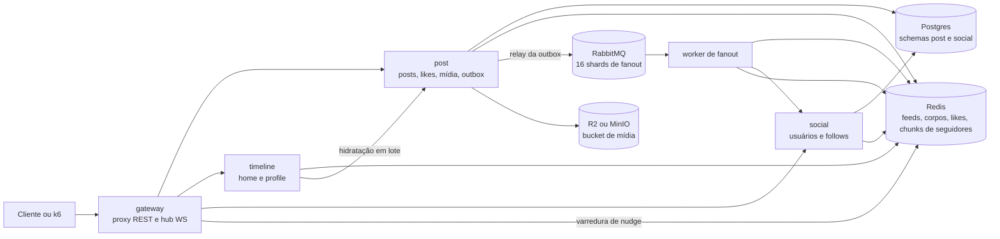
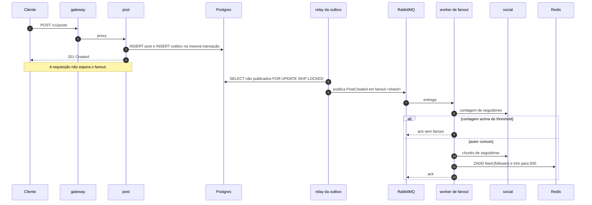
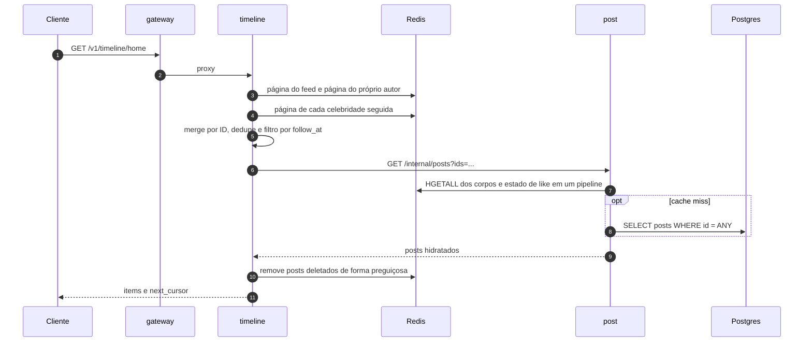

# Wayposts

**Laboratório de carga para o desenho de um feed social.** O Wayposts implementa os
caminhos de escrita e leitura de um feed no estilo do Twitter e mede onde o desenho
rompe sob carga. Não é um produto.

[English](README.md) | **Português (Brasil)**

[Início rápido](#início-rápido) · [API](#api) · [Arquitetura](#arquitetura) ·
[Testes de carga](#testes-de-carga) · [Resultados](#resultados-da-fase-0) ·
[Desenvolvimento](#desenvolvimento) · [Limites](#limites-conhecidos)

## O que faz

- Publica posts com até 2.000 caracteres e quatro imagens.
- Curte e descurte com script Lua idempotente no Redis e persistência em lote.
- Segue e deixa de seguir, com listas de seguidores em cache por chunk.
- Lê a Home Timeline montada por fanout híbrido: push para autores comuns, merge para
  celebridades.
- Lê a Profile Timeline.
- Faz soft delete. As timelines descartam posts deletados de forma preguiçosa.
- Avisa clientes conectados sobre posts novos por WebSocket.
- Expõe métricas Prometheus em todos os serviços.

Fora de escopo: respostas, reposts, busca, hashtags, DMs, notificações persistidas,
ranking, moderação e apps mobile.


O console em `web/` é o cliente visual da API. Ele mostra a home timeline, escritas,
likes, follows, perfis e o indicador de nudge em tempo real. O trilho direito lê o
`/metrics` do gateway a cada 5 segundos e mostra taxa de requisições, p95, erros,
requisições em andamento, leituras de timeline, escritas e likes. A interface está
disponível em inglês e português do Brasil.

## Início rápido

Pré-requisitos: Go 1.26+ e Docker 28+ com Compose v2. O `go.mod` baixa o toolchain
automaticamente. O k6 roda em container.

```sh
make up        # Postgres, Redis, RabbitMQ, MinIO
make migrate
make seed      # 2.000 usuários, 3 celebridades, teto de 400 seguidores por autor comum
make run       # builda e sobe os cinco serviços
```

`make run` sobe cinco processos:

| Serviço | Endereço | Papel |
|---|---|---|
| `gateway` | `:8080` | Proxy REST, auth de desenvolvimento, hub WebSocket, varredura de nudge |
| `post` | `:8081` | Posts, likes, mídia, outbox, hidratação interna |
| `timeline` | `:8082` | Home e Profile timelines, merge |
| `social` | `:8083` | Usuários, follows, cache de seguidores |
| `fanout` | `:8084` | Worker de fanout, expõe apenas health e metrics |

Em outro terminal:

```sh
make demo      # follows, post comum, post de celebridade, like e as duas timelines
make nudge     # conexão WebSocket e aviso de post novo
make media     # presign, upload direto e validação por HEAD no MinIO
```

Encerre os serviços com Ctrl-C no terminal do `make run`. Depois:

```sh
make down      # para os containers e mantém o volume
make reset     # recria os containers e apaga os dados
```

`make seed` trunca as tabelas e roda `FLUSHDB` por default. Pare os serviços antes com
`./scripts/stop.sh`. Rodar com o fanout ativo deixa a outbox e os caches inconsistentes.

As portas locais padrão são 5432 para Postgres, 6379 para Redis, 5672 e 15672 para
RabbitMQ, e 9000 e 9001 para MinIO. Se alguma estiver ocupada, publique outra porta no
`docker-compose.yml` e ajuste `DATABASE_URL`, `REDIS_ADDR`, `RABBIT_URL` ou
`S3_ENDPOINT`. O `scripts/dev.sh` configura o MinIO no serviço de post. Deixe
`MEDIA_BUCKET` vazio para rodar sem upload.

### Primeiras chamadas

A auth de desenvolvimento usa um bearer token igual ao ID do usuário semeado. Isso não é
auth de produção. O seed cria usuários `1..N`; os usuários `1..CELEBS` são celebridades.

```sh
# usuário 10 publica
curl -s -X POST localhost:8080/v1/posts \
  -H 'Authorization: Bearer 10' -H 'Content-Type: application/json' \
  -d '{"body":"olá"}'

# usuário 11 segue o 10
curl -s -X POST localhost:8080/v1/follow \
  -H 'Authorization: Bearer 11' -H 'Content-Type: application/json' \
  -d '{"followee_id":10}'

# usuário 11 lê a Home Timeline
curl -s 'localhost:8080/v1/timeline/home?limit=20' \
  -H 'Authorization: Bearer 11'
```

O primeiro post pode demorar um pouco para aparecer porque o fanout é assíncrono. Quem
publicou vê o próprio post na hora pelo caminho de read-your-writes.

## API

Todas as rotas públicas passam pelo gateway e exigem bearer token. As exceções são
`/healthz` e `/metrics`, além de `/v1/ws`, que usa o parâmetro `token`.

| Método | Rota | Função |
|---|---|---|
| `POST` | `/v1/posts` | Cria um post com `body` e chaves opcionais em `media` |
| `GET` | `/v1/posts/{id}` | Lê um post |
| `DELETE` | `/v1/posts/{id}` | Faz soft delete do seu post |
| `POST` | `/v1/posts/{id}/likes` | Curte um post |
| `DELETE` | `/v1/posts/{id}/likes` | Remove o like |
| `POST` | `/v1/media/presign` | Emite URLs assinadas para tipos de imagem |
| `POST` | `/v1/follow` | Segue `followee_id` |
| `DELETE` | `/v1/follow/{id}` | Deixa de seguir |
| `GET` | `/v1/users/{id}` | Lê handle, nome e contagem de seguidores |
| `GET` | `/v1/timeline/home` | Página da Home Timeline |
| `GET` | `/v1/timeline/profile/{id}` | Página da Profile Timeline |
| `GET` | `/v1/ws?token={uid}&last_seen={postID}` | Stream de nudge por WebSocket |
| `GET` | `/healthz` | Liveness |
| `GET` | `/metrics` | Métricas Prometheus |

As timelines aceitam `before`, um ID de post, e `limit`, com default 20 e teto de 50. A
resposta é `{"items": [...], "next_cursor": <postID>}`.

`POST /v1/media/presign` recebe `{"items":[{"content_type":"image/png","size":70}]}` e
devolve chave, URL de `PUT` assinada, headers e validade. O cliente envia o arquivo
direto ao bucket e manda a chave em `POST /v1/posts`. A API confere o objeto com `HEAD`:
precisa existir, estar sob o prefixo do autor, ser imagem e ficar abaixo de
`MEDIA_MAX_BYTES`, 10 MiB por default. Os tipos aceitos são JPEG, PNG e WebP.

## Arquitetura

Cinco deployables compartilham pacotes Go. O Postgres é a fonte da verdade. O Redis
serve o feed materializado, os corpos de post em cache, os likes e os chunks de
seguidores. O RabbitMQ leva um evento `PostCreated` por post até os workers de fanout. O
bucket de objetos guarda mídia.

O problema central é o custo de fanout. Empurrar um post para o feed de cada seguidor
custa posts vezes seguidores, então um post de uma conta com 10 milhões de seguidores
vira 10 milhões de escritas. O Wayposts divide os autores em um threshold: abaixo dele,
o post é empurrado para o feed de cada seguidor; acima dele, o leitor faz o merge dos
posts recentes do autor na leitura. O laboratório existe para medir os dois lados dessa
divisão.



| Serviço | Responsabilidade | Dados que possui |
|---|---|---|
| `gateway` | Proxy REST, auth bearer de desenvolvimento, conexões WebSocket, varredura de nudge | Nenhum estado compartilhado. As conexões WS vivem na instância |
| `post` | Criar, ler e deletar posts, validar mídia, likes, relay da outbox | Postgres schema `post`; Redis `post:{id}`, `author:{u}`, `likes:{post}` |
| `timeline` | Home e Profile timelines, merge, hidratação | Lê Redis `feed:{u}`, `author:{u}`, `celeb_follows:{u}` |
| `social` | Usuários, grafo de follows, contagem e cache de seguidores | Postgres schema `social`; Redis `followers:{author}:{chunk}`, `celeb_follows:{u}` |
| `fanout` | Consumir `PostCreated` e escrever nos feeds | Nenhum banco próprio |

### Caminho de escrita



O commit do post e o commit do evento acontecem juntos. Se o broker estiver fora, a
linha fica sem publicar e o relay tenta de novo. O relay roda a cada 50 ms, publica até
200 eventos por lote e divide por autor em 16 filas, para uma conta grande não bloquear
todos os consumidores.

Autores acima de `FANOUT_THRESHOLD`, 10.000 seguidores por default, não recebem push.
Os posts ficam no índice do autor e o caminho de leitura faz o merge. Isso mantém o
custo de escrita independente das maiores audiências e move trabalho para o leitor.

O fanout é idempotente porque cada entrada de feed é um `ZADD` com `score = postID`.
Reentregar repete a mesma escrita. O feed tem teto de 500 entradas.

### Caminho de leitura



A Home Timeline junta quatro fontes:

1. A página materializada de `feed:{u}`.
2. A página de `author:{u}` do próprio leitor, para um post novo aparecer antes de o
   fanout terminar.
3. `author:{celeb}` de cada celebridade em `celeb_follows:{u}`, filtrado para posts
   criados depois do follow.
4. O cursor da página, aplicado como `max = before` em toda leitura de ZSET.

Os corpos são hidratados em uma chamada em lote. O serviço de post lê os hashes do Redis
em pipeline e cai para o Postgres nos misses. Posts deletados são pulados e removidos do
feed na leitura, sem fanout de delete.

A Profile Timeline lê só `author:{authorID}`, então devolve no máximo os 200 posts mais
recentes em cache para aquele autor.

### Decisões de desenho

| Decisão | Por quê | Custo |
|---|---|---|
| Fanout híbrido | O custo de escrita para de crescer com as maiores audiências | O leitor faz merge de duas fontes e pagina entre elas |
| Feed de IDs | Uma entrada por post por seguidor, sem copiar o corpo | Hidratação exige 20 leituras de cache por página e um caminho de miss no Postgres |
| Outbox transacional e filas sharded | Nenhum post se perde entre commit e publicação | Entrega at-least-once, tabela de outbox que precisa de poda, um processo de relay |
| IDs de 53 bits | Exatos como score `float64` de ZSET e como número em JavaScript | Epoch própria, 64 nós geradores, 64k IDs/s por nó |
| Likes no Redis primeiro | Nenhuma linha quente no Postgres para um post viral | Até 100 ms de likes perdidos em crash, contador pode ficar à frente da tabela |
| Cache de seguidores em chunks | Uma leitura no Redis por 1.000 seguidores, não uma por seguidor | Cache e tabela podem divergir, a reconstrução precisa checar geração |
| Nudge por varredura | O caminho de escrita não conhece WebSocket | Até 30 s de atraso, e posts de celebridade não geram nudge |
| Upload de mídia por presign | Bytes de imagem não passam pela API | Uma checagem `HEAD` separada na criação do post |

O raciocínio completo e as alternativas estão em [`docs/adr/`](docs/adr/). O vocabulário
do domínio está em [`CONTEXT.md`](CONTEXT.md).

### Modelo de dados

Postgres:

| Schema | Tabela | Função |
|---|---|---|
| `post` | `posts` | Corpo, chaves de mídia, data de criação, flag de delete, contagem de likes |
| `post` | `likes` | Likes duráveis, fonte para reconstruir o contador |
| `post` | `outbox` | Eventos não publicados, drenados pelo relay |
| `social` | `users` | Handle, nome, contagem materializada de seguidores |
| `social` | `follows` | Arestas direcionadas de follow |

Redis:

| Chave | Tipo | Conteúdo | Retenção |
|---|---|---|---|
| `feed:{u}` | ZSET | IDs de post, score igual ao ID | Teto 500 |
| `author:{u}` | ZSET | Últimos 200 IDs de post do autor | Teto 200 |
| `post:{id}` | HASH | Corpo, contadores, mídia, flag de delete | TTL 24 h e LRU |
| `likes:{post}` | SET | IDs que curtiram o post | TTL 7 d e LRU |
| `followers:{author}:{chunk}` | SET | Até 1.000 seguidores | TTL 24 h |
| `followers_meta:{author}` | string | Número de chunks, expira 1 h antes deles | TTL 23 h |
| `followers_gen:{author}` | string | Geração do cache para detectar corrida | TTL 7 d |
| `celeb_follows:{u}` | ZSET | Celebridade para horário do follow | Mantido no follow |

Os corpos vivem 24 h no Redis e depois caem para o Postgres. As entradas de feed vivem
até o teto expulsá-las. Perder o Redis perde os feeds materializados; não há reconstrução
a partir do Postgres, então um restart exige rodar o seed de novo.

### Premissas e SLOs

| Premissa | Valor |
|---|---|
| DAU | 20.000.000 |
| Posts por usuário por dia | 10 |
| Aberturas de app por usuário por dia | 10 |
| Seguidores por autor | Power law, mediana ~150, p99 ~5k, máximo 1M |
| Likes por post | ~5 |
| Posts com mídia | ~20% |
| Conexões WebSocket concorrentes | 5 a 10% do DAU |

| Carga derivada | Média | Pico, ~4x |
|---|---|---|
| Posts/s | 2.315 | 9.260 |
| Leituras de timeline/s | 2.315 | 9.260 |
| Likes/s | 11.574 | 46.296 |
| Escritas de feed em ZADD/s | ~463k | ~1,85M |
| Uploads de mídia/s | ~463 | ~1.852 |

| Operação | p99 alvo |
|---|---|
| `POST /v1/posts` | 300 ms, sem contar fanout |
| `GET /v1/timeline/home` e profile | 150 ms |
| Like e unlike | 100 ms |
| Fanout lag | p95 2 s, p99 10 s |
| Taxa de 5xx | abaixo de 0,1% |
| Atraso do nudge | 30 s |

Saturação é o primeiro patamar em que um SLO quebra por 5 minutos seguidos ou os erros
passam de 1%. Estes são alvos de desenho, não medições. Os números da fase 0 abaixo são
medições de um deploy pequeno.

## Testes de carga

O harness usa k6 em modelo aberto: a taxa de chegada é fixa e independente da latência.
Modelo fechado esconde o joelho porque respostas lentas reduzem a pressão. O método
completo está em [`load/README.md`](load/README.md).

```sh
./scripts/load.sh steady
RATE=200 DURATION=5m ./scripts/load.sh steady
START_RATE=50 MAX_RATE=1500 ENFORCE=0 ./scripts/load.sh ramp
```

| Cenário | Default | Objetivo |
|---|---|---|
| `steady` | 50 iters/s por 2 min | Linha de base e estabilidade |
| `ramp` | 20 a 1.000 iters/s, 1 min de warmup, 10 min de rampa, 2 min de hold | Achar o joelho e confirmá-lo |
| `spike` | 100 iters/s, 10x por 60 s | Fila, backlog e recuperação |
| `soak` | 80 iters/s por 30 min | Vazamento, GC, TTL, crescimento de conexões |
| `celebrity` | 50 iters/s por 3 min, 10% de escritas de celebridade | Caminho de merge sob carga |
| `cold-cache` | 20 iters/s por 2 min depois de `make flush-posts` | Hidratação sem cache de corpo |

A mistura padrão é 85% Home Timeline, 5% Profile Timeline, 7% criação de post e 3% de
likes. `RATE` conta iterações, não requisições. Os thresholds aplicam a tabela de SLOs e
o k6 sai com código 99 quando um deles quebra. Use `ENFORCE=0` durante a rampa e
`ENFORCE=1` na medição final.

Fanout lag não é uma métrica HTTP. Consulte no Prometheus:

```promql
histogram_quantile(0.95, sum by (le) (rate(wayposts_fanout_lag_seconds_bucket[5m])))
sum(rate(wayposts_fanout_feed_writes_total[1m]))
sum by (result) (rate(wayposts_fanout_messages_total[1m]))
```

Para reproduzir o grafo da fase 0 localmente:

```sh
make seed USERS=20000 FOLLOWS=200 CELEBS=3 CELEB_FOLLOWERS=12000 MAX_FOLLOWERS=8000
make run THRESHOLD=10000
```

## Resultados da fase 0

A fase 0 rodou em um worker compartilhado de Helsinki: 20.000 usuários, 4.033.532
arestas de follow, três celebridades com 12.000 seguidores cada, uma réplica por
serviço. O worker também hospeda outras cargas. Estes números validam deploy, contrato e
instrumentação. Eles não estabelecem capacidade.

| Cenário | Taxa | Iterações | Erros | p99 total | p99 home | p99 post | Fanout lag p95 / p99 |
|---|---|---|---|---|---|---|---|
| steady | 50 iters/s por 3 min | 9.001 | 0% | 34 ms | 43 ms | 18 ms | 99 ms / 218 ms |
| ramp | 50 a 200 iters/s por 3,5 min | 28.498 | 0% | 151 ms | não reportado | não reportado | não reportado |

Todos os SLOs da fase 0 passaram no steady. A rampa rodou com `ENFORCE=0`, então o
resumo não tem breakdown por tag. O agregado de 151 ms é a única leitura disponível.

Status: a fatia vertical, likes, nudge, mídia, métricas e cache de seguidores estão
concluídos, e a fase 0 está deployada. Os próximos passos são a curva de saturação em
escala reduzida e os nós temporários da fase 1.

## Deploy

Os manifests em `deploy/k8s` miram um deploy pequeno de fase 0 em k3s de um nó só. Eles
reaproveitam um operador CloudNativePG e o stack Prometheus existentes, rodam uma
réplica por serviço e incluem Jobs de migration, seed e k6. O runbook está em
[`deploy/k8s/README.md`](deploy/k8s/README.md).

A fase 1 está planejada para nós temporários na mesma região do gerador de carga, com o
gerador em uma VPS separada. O gerador não pode dividir nó com os serviços medidos nem
rodar pela WAN, porque o RTT dominaria o p99.

## Desenvolvimento

```sh
make build
make test              # testes unitários; o teste de Postgres é pulado sem TEST_DATABASE_URL
make vet
make test-integration  # roda o teste do cache de seguidores contra DATABASE_URL
```

Os testes cobrem o gerador de ID, a varredura de nudge, as regras de chave de mídia e a
coalescência de likes. O teste do cache de seguidores usa miniredis e Postgres e precisa
de `TEST_DATABASE_URL` apontando para um banco com as migrations aplicadas. Não há teste
de ponta a ponta automatizado. `make demo`, `make nudge` e `make media` são checagens
manuais contra o stack rodando.

Layout:

| Caminho | Conteúdo |
|---|---|
| `cmd/` | Um binário por deployable, mais `migrate`, `seed` e `wsprobe` |
| `internal/` | Domínio e pacotes compartilhados |
| `db/migrations/` | Schema SQL, embutido no binário de migration |
| `load/` | Cenários e helpers k6 |
| `deploy/` | Imagem k6, base k8s e overlay do orbit |
| `scripts/` | Runners de dev, demo e carga |
| `docs/adr/` | Decisões de arquitetura |

Todo serviço expõe `/healthz` e `/metrics`. As métricas usam o prefixo `wayposts_` e
carregam o label `service`.

### Stack

| Camada | Escolha | Por quê |
|---|---|---|
| Linguagem | Go 1.26 | Binários pequenos, concorrência barata, pprof nativo |
| HTTP | `net/http` e `chi` | Roteamento simples, sem framework |
| Postgres | CloudNativePG no cluster, Postgres 17 no Compose | Fonte da verdade durável |
| Redis | Redis 8 ou Valkey | Feeds em ZSET, likes em Lua, cache com LRU |
| Fila | RabbitMQ 4 | Ack, retry e DLQ por mensagem |
| Objetos | Cloudflare R2, compatível com S3 | Upload assinado e CDN pública |
| Métricas | Prometheus e Grafana | Já disponíveis no cluster |
| Carga | k6 em modelo aberto e seeder em Go | Taxa de chegada independente da latência |
| Web | React 19, Vite e Cloudflare Workers | Console visual de timelines, escritas e métricas ao vivo do gateway |

## Limites conhecidos

- A memória do feed é o maior custo fixo: 20M usuários com 500 entradas dão cerca de
  320 GB. O teto é variável de experimento.
- O Redis não é durável. Perder o Valkey perde os feeds materializados, e não há
  reconstrução a partir do Postgres.
- A Profile Timeline lê só os 200 posts mais recentes em cache por autor.
- Likes podem perder até 100 ms de eventos em crash antes do flush do buffer.
- A outbox não tem job de retenção. Linhas publicadas se acumulam para sempre.
- Cache de seguidores e Postgres podem divergir entre janelas de TTL; não há job de
  reconciliação.
- Mudar o threshold afeta só posts novos. Autores já seguidos mantêm posts antigos no
  feed.
- O nudge cobre apenas o feed materializado, então posts de celebridade não geram aviso.
- Sem `MEDIA_BUCKET`, o serviço de post aceita só texto.
- A validação de mídia confia no `Content-Type` do objeto; não inspeciona os bytes da
  imagem.
- A fase 0 roda uma réplica por serviço, sem alta disponibilidade.
- O delete é preguiçoso na leitura. Não há fanout de delete.

## Documentação

- [Arquitetura](docs/architecture.md)
- [Vocabulário do domínio](CONTEXT.md)
- [Decisões de arquitetura](docs/adr/)
- [Testes de carga](load/README.md)
- [Runbook de deploy](deploy/k8s/README.md)
- [Fonte do diagrama para blog, Excalidraw](docs/wayposts-architecture.excalidraw)
