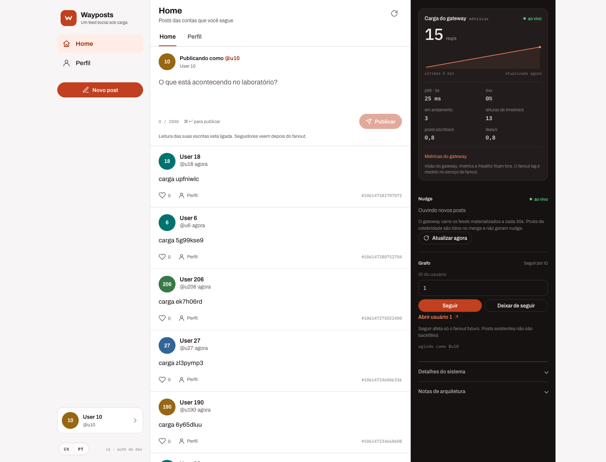

# Wayposts web

Console visual do laboratório. É um SPA em React e Vite, servido como assets
estáticos por um Worker da Cloudflare. Ele fala com o gateway do cluster através
do túnel `orbit-eu-tunnel`.



## O que a tela faz

- Troca de identidade pelo ID do usuário semeado.
- Home Timeline com paginação por cursor.
- Profile Timeline por usuário.
- Publicar post de texto.
- Curtir e descurtir.
- Seguir e deixar de seguir.
- Deletar posts do próprio usuário.
- Aviso de nudge por WebSocket, com reconexão automática.
- Painel de tráfego ao vivo lendo o `/metrics` do gateway: req/s, p95 de 5s, 5xx,
  requisições em andamento, leituras de timeline, escritas e likes.
- Interface em inglês e português do Brasil, com preferência persistida.
- Links para `/healthz` e `/metrics` no painel de sistema.

O trilho direito não inventa tráfego. Quando o gerador não está rodando, ele mostra
`./scripts/load.sh steady` para acordar o painel. O p95 é calculado sobre a janela de
5 segundos entre coletas; o sparkline guarda os últimos 5 minutos.

A auth é a de desenvolvimento: o bearer token é o ID do usuário. Não use esta
tela como interface de produção.

## Rodando local

Com a infra e os serviços no ar:

```sh
make up
make migrate
make seed
make run
```

Em outro terminal:

```sh
make web-install
make web-dev
```

Abra `http://localhost:5173`. O padrão de `VITE_API_URL` é
`http://localhost:8080`, e o gateway já libera `localhost:5173` no CORS.

Para apontar para outra API, crie `web/.env.local`:

```sh
VITE_API_URL=https://wayposts-api.marcio.run
```

Build local:

```sh
make web-build
npm --prefix web run preview
```

## Cloudflare Workers Builds

O Worker serve apenas os arquivos de `web/dist`. Não há SSR nem proxy de API: o
browser chama a API diretamente, e o gateway responde o preflight CORS.

No dashboard, em **Workers & Pages > Create application**:

| Campo | Valor |
|---|---|
| Repositório | `marcioecom/wayposts` |
| Project name | `wayposts` |
| Path / Root directory | `web` |
| Build command | `npm ci && npm run build` |
| Deploy command | `npx wrangler deploy` |
| Preview command | `npx wrangler preview` |
| Build variable | `VITE_API_URL=https://wayposts-api.marcio.run` |
| Build variable, se o build image usar Node antigo | `NODE_VERSION=22` |

O `wrangler.jsonc` já aponta para `./dist` e usa fallback de SPA. O nome do Worker
também é `wayposts`.

Não deixe o Path em `/`: o `wrangler` rodaria na raiz do monorepo Go, sem
`package.json` nem `wrangler.jsonc`.

Se usar Preview builds, mantenha os previews no ar. O CORS do laboratório aceita
`https://*.workers.dev`, então os previews conseguem chamar a API. Remova esse
curinga de `CORS_ALLOWED_ORIGINS` quando não precisar mais deles.

## Domínio e túnel

O frontend fica em `wayposts.marcio.run` e a API em `wayposts-api.marcio.run`.
O Echo usa o mesmo desenho com `app.marcio.run` e `echo-api.marcio.run`.

### 1. Rota do túnel para a API

No dashboard Zero Trust, abra **Networks > Tunnels > orbit-eu-tunnel > Routes >
Add route** e publique:

| Campo | Valor |
|---|---|
| Subdomain | `wayposts-api` |
| Domain | `marcio.run` |
| Path | vazio |
| Service | `http://gateway.wayposts.svc.cluster.local:8080` |

O serviço `gateway` do namespace `wayposts` escuta na porta 8080. O túnel alcança
o DNS interno do cluster, então não é preciso Ingress.

Se o dashboard não criar o DNS sozinho, adicione um CNAME:

| Tipo | Nome | Conteúdo | Proxy |
|---|---|---|---|
| CNAME | `wayposts-api` | `<tunnel-id>.cfargotunnel.com` | Proxied |

O `<tunnel-id>` aparece na visão geral do `orbit-eu-tunnel` e é o mesmo usado
pelos registros do Echo.

O túnel do orbit é gerenciado pelo Pulumi. Se você criar a rota apenas pelo
dashboard, o próximo `pulumi up` pode sobrescrever a configuração e remover a
rota do Wayposts. Para persistir, adicione a rota no projeto do orbit, como no
exemplo no fim desta página.

### 2. Domínio do Worker

Em **Workers & Pages > wayposts > Settings > Domains & Routes**, adicione o
custom domain `wayposts.marcio.run`. A Cloudflare cria o registro e o
certificado.

### 3. CORS no gateway

O gateway libera as origens configuradas em `CORS_ALLOWED_ORIGINS`. O valor no
`deploy/k8s/base/config.yaml` é:

```yaml
CORS_ALLOWED_ORIGINS: "https://wayposts.marcio.run,https://*.workers.dev,http://localhost:5173,http://127.0.0.1:5173"
```

Se você trocar o domínio do frontend, atualize esse valor e reaplique:

```sh
kubectl apply -f deploy/k8s/base/config.yaml
kubectl -n wayposts rollout restart deploy/gateway
```

O preflight de `OPTIONS` é respondido antes da auth. A API usa bearer token, sem
cookies, então o CORS não precisa de `Access-Control-Allow-Credentials`.

## Opcional: túnel pelo Pulumi do orbit

O repositório `orbit` já cria o túnel e o DNS do Echo. Para trazer o Wayposts
para o mesmo IaC, adicione um CNAME no projeto e uma rota na configuração do
túnel.

Exemplo de DNS, no padrão de `src/projects/echo/edge.ts`:

```ts
const dnsRecord = new cloudflare.DnsRecord("wayposts-api-public-dns", {
  zoneId: settings.cloudflare.zoneId!,
  name: "wayposts-api.marcio.run",
  type: "CNAME",
  content: tunnel.id.apply((id) => `${id}.cfargotunnel.com`),
  proxied: true,
  ttl: 1,
}, { dependsOn: [tunnel] });
```

E a rota correspondente:

```ts
configureTunnelRoutes(edge.tunnel, [
  echo.tunnelRoute,
  {
    hostname: "wayposts-api.marcio.run",
    service: "http://gateway.wayposts.svc.cluster.local:8080",
  },
]);
```

O deploy do Wayposts continua no `deploy/k8s` deste repositório. O Pulumi do
orbit cuidaria apenas do DNS e da rota do túnel.

## Troubleshooting

- **Tela vazia ou erro de rede**: confira `VITE_API_URL` no build do Worker e se
  `https://wayposts-api.marcio.run/healthz` responde.
- **Erro de CORS no console**: confira `CORS_ALLOWED_ORIGINS` no ConfigMap e se o
  gateway foi reiniciado depois do apply.
- **401**: o ID do usuário precisa ser positivo. A auth de desenvolvimento não
  valida se o usuário existe.
- **Timeline vazia**: siga alguém e publique com essa conta. O follow não faz
  backfill, e o fanout é assíncrono.
- **Nudge não chega**: posts de celebridade não geram nudge, e a varredura roda a
  cada 30s no cluster.
- **Mídia não aparece**: o deploy do orbit sobe com `MEDIA_BUCKET` vazio. A tela
  atual publica apenas texto.
